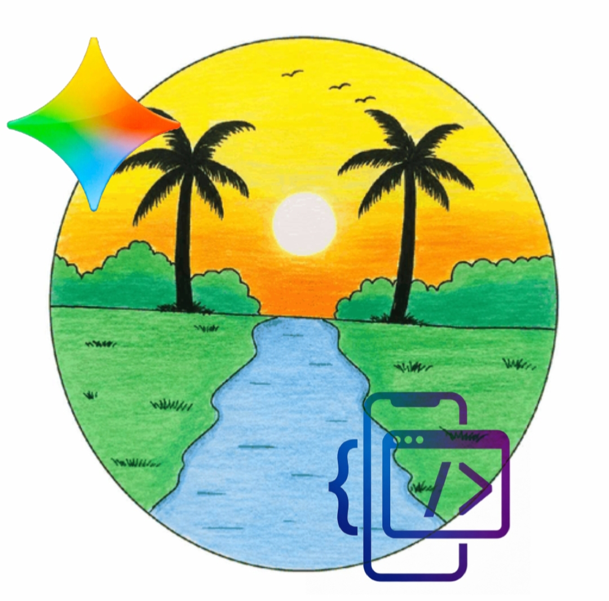
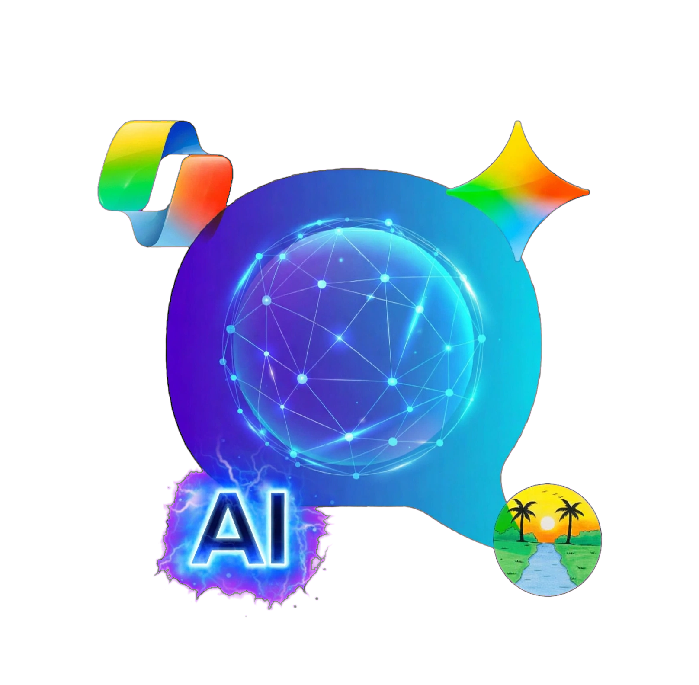
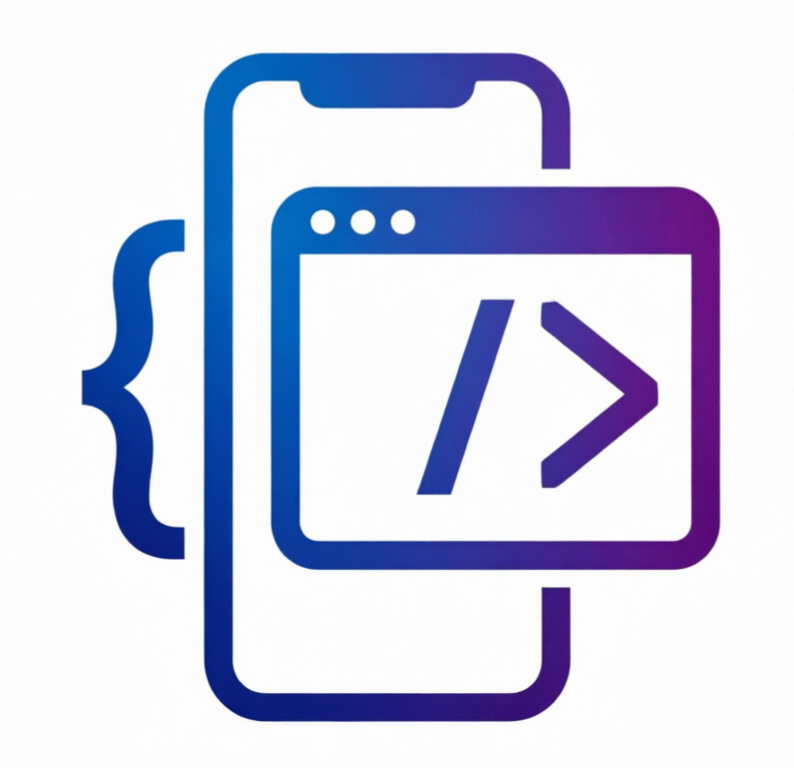
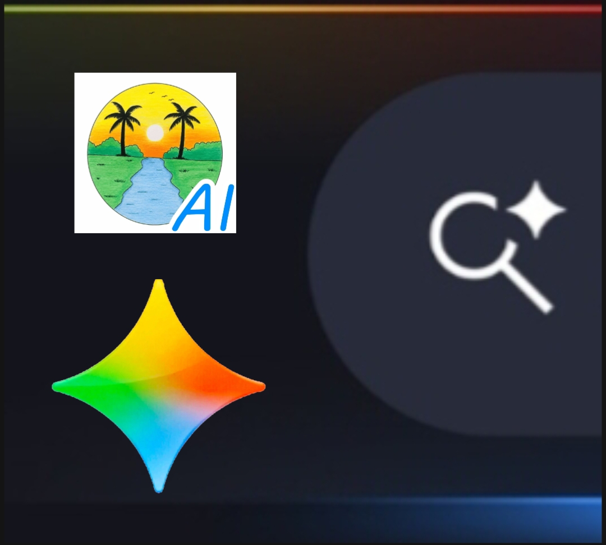
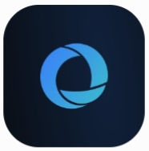
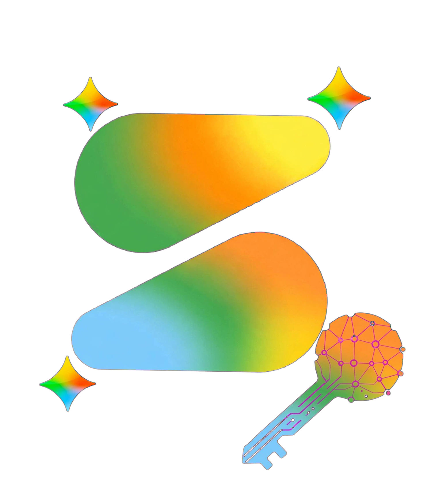
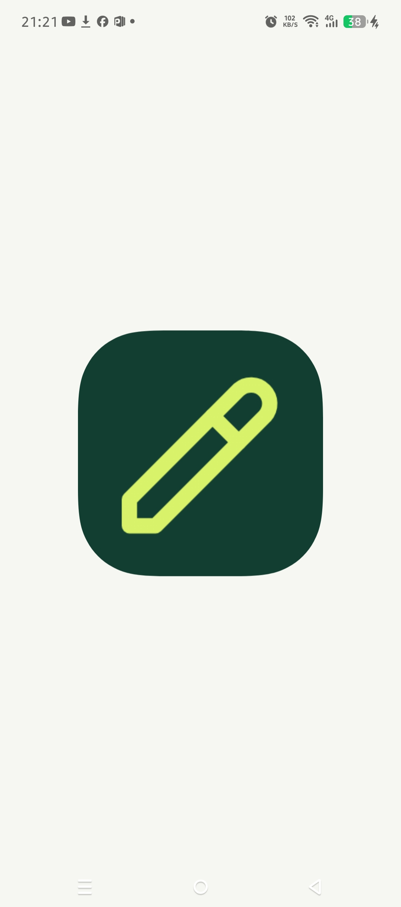
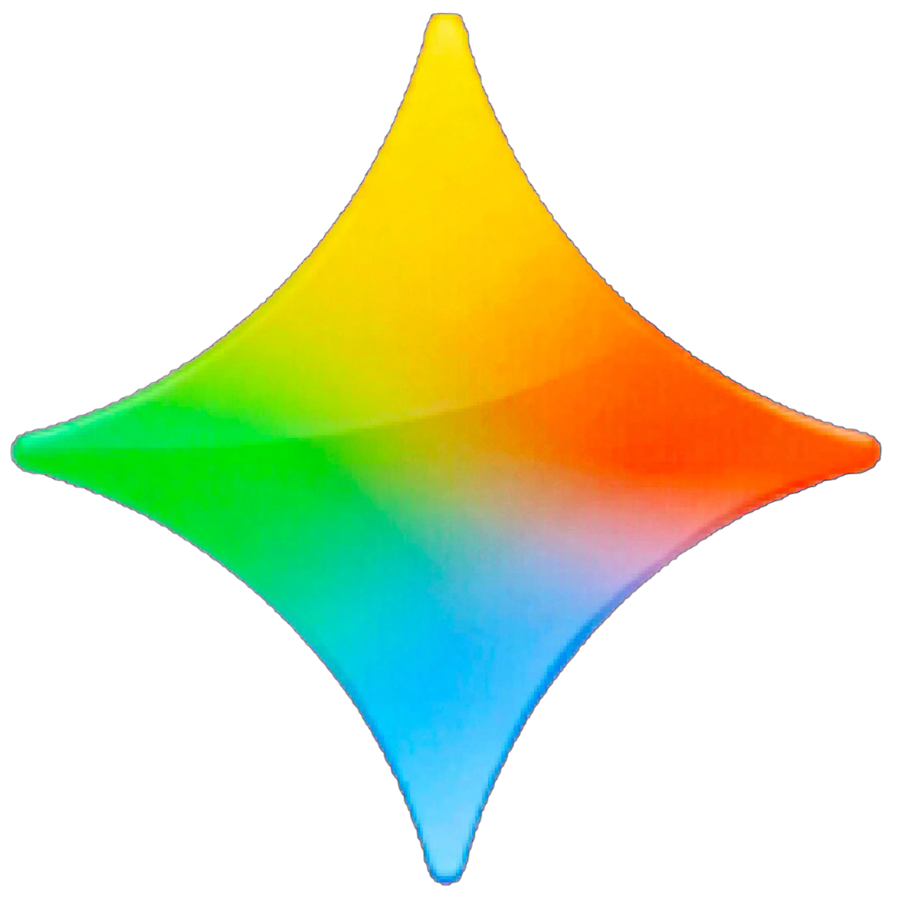

<!DOCTYPE html>
<html lang="ar" dir="rtl">
<head>
  <meta charset="UTF-8" />
  <meta name="viewport" content="width=device-width, initial-scale=1.0" />
  <title>Alislamiah For Developers</title>
  <link rel="preconnect" href="https://fonts.googleapis.com">
  <link rel="preconnect" href="https://fonts.gstatic.com" crossorigin>
  <link href="https://fonts.googleapis.com/css2?family=Tajawal:wght@400;500;700;800;900&display=swap" rel="stylesheet">
  
</head>
<body>

  <nav class="nav">
    

      <a href="#" class="logo">
        
        Alislamiah
      </a>
      <ul class="nav-links">
        <li><a href="#about">عن الشبكة</a></li>
        <li><a href="#tools">الأدوات</a></li>
        <li><a href="https://Alislamiah.github.io/Hani-AI/" class="nav-cta">Hani AI</a></li>
      </ul>
    

  </nav>

  <header class="hero">
    

    

      
✦ شبكة Alislamiah الرقمية

      <h1>Alislamiah For Developers</h1>
      

        شبكة رقمية توفر خدمات متعددة تساعد المطورين وترفه عن المستخدمين. 
        أدوات قوية وذكاء اصطناعي في مكان واحد.
      

      

        <a href="https://Alislamiah.github.io/Hani-AI/" class="btn btn-primary">جرب Hani AI</a>
        <a href="#tools" class="btn btn-outline">استكشف الأدوات</a>
      

      

        

          
        

        

          <h3>نقدم لك Hani AI</h3>
          
مساعدك الذكي داخل شبكة الإسلامية — جربه الآن واكتشف القوة الحقيقية.

          <a href="https://l2z.netlify.app" class="btn btn-primary">انتقل إلى Hani AI</a>
        

      

    

  </header>

  

  <section id="about">
    

      

        <h2>شبكة Alislamiah</h2>
        
شبكة الإسلامية هي شبكة رقمية توفر خدمات متعددة تساعد المطورين وترفه عن المستخدمين

      

      

        

          
          <h3>أدوات المطورين</h3>
          
مجموعة متكاملة من المنصات المصممة خصيصاً لمساعدة المطورين في بناء مشاريعهم بسرعة وكفاءة.

        

        

          
          <h3>ذكاء اصطناعي</h3>
          
Hani AI و Gemalot — مساعدان ذكيان يدمجان قوة الذكاء الاصطناعي مع احتياجات المستخدم والمطور.

        

        

          
          <h3>منصات متعددة</h3>
          
منصات متنوعة ومترابطة تخدم المطورين والمستخدمين في بيئة واحدة منظمة وسهلة الاستخدام.

        

      

    

  </section>

  

  <section id="tools">
    

      

        <h2>أدوات المطورين</h2>
        
كل الأدوات والمنصات في مكان واحد

      

      

        <a href="https://Alislamiah.github.io/Hani-AI/" class="tool featured">
          

            
          

          

            
Hani AI

            
الذكاء الاصطناعي · المنصة الرئيسية

            
نقدم لك Hani AI — جرب المنصة الآن واستمتع بتجربة ذكية متكاملة ضمن شبكة الإسلامية.

            
جرب المنصة ←

          

        </a>

        <a href="https://alislamiah.github.io/outhub/" class="tool">
          

            

              
            

            

              
Outhub

              
منصة تطوير

            

          

          
طور مواقعك وتطبيقاتك بواسطة الإسلامية — بيئة متكاملة للمطورين.

          
فتح الأداة ←

        </a>

        <a href="https://alislamiah.github.io/Outbase/" class="tool">
          

            

              
            

            

              
Outbase

              
قواعد البيانات

            

          

          
أداة قوية لإدارة والتعامل مع قواعد البيانات ضمن منظومة Alislamiah.

          
فتح الأداة ←

        </a>

        <a href="https://alislamiah.github.io/Alislamiah-API-studio/" class="tool">
          

            

              
            

            

              
API Studio

              
واجهات برمجة

            

          

          
استوديو متكامل لبناء واختبار وإدارة واجهات الـ API بسهولة واحترافية.

          
فتح الأداة ←

        </a>

        <a href="https://alislamiah.github.io/Alislamiah-search-console/" class="tool">
          

            

              
            

            

              
Search Console

              
فهرسة المواقع

            

          

          
اطلب فهرسة مواقعك لتظهر في نتائج البحث داخل شبكة الإسلامية.

          
فتح الأداة ←

        </a>

        <a href="https://nazim10-u.github.io/nazim/" class="tool">
          

            

              
            

            

              
مداد

              
كتابة وتدوين

            

          

          
منصة مداد للكتابة والتدوين — أداة أنيقة ومنظمة للمحتوى.

          
فتح الأداة ←

        </a>

        <a href="https://alislamiah.github.io/Gemalot/" class="tool">
          

            

              
            

            

              
Gemalot

              
مساعد ذكي

            

          

          
مساعد الإسلامية الرقمي — Alislamiah AI Assistant للإجابة والمساعدة.

          
فتح الأداة ←

        </a>

      

    

  </section>

  

  <section class="cta">
    

      

        <h2>جاهز لتجربة Hani AI؟</h2>
        
انتقل مباشرة إلى المنصة واستكشف قدرات الذكاء الاصطناعي ضمن شبكة الإسلامية.

        <a href="https://Alislamiah.github.io/Hani-AI/" class="btn btn-primary">جرب Hani AI الآن</a>
      

    

  </section>

  <footer>
    

      

        
        Alislamiah For Developers
      

      

        شبكة الإسلامية — أدوات تساعد المطورين وترفه عن المستخدمين 
        © 2026 Alislamiah
      

    

  </footer>

</body>
</html>
